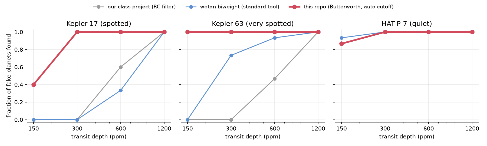

# kepler-transit-detrending

This started as my EECS 50 (signals and systems) project with two teammates: a first order RC high-pass to strip starspot variation out of Kepler light curves so transits are easier to see. We discretized it to y[n] = a(y[n-1] + x[n] - x[n-1]) with a = RC/(RC+T), ran it on Kepler-17, and found the transit depth that survives goes like e^(-π fc T14). The catch is that one RC stage only rolls off at 20 dB/decade and the spots sit less than two decades below the transit, so you can't kill one without eating the other.

This repo is what I did after the class ended: try to actually fix that, and test it in a way I'd trust.

Short version of the result: a zero-phase 2nd order Butterworth, with the cutoff picked from each light curve, finds about twice as many small injected planets on spotted stars as our class filter (Kepler-17 went from 40% to 85%, Kepler-63 from 37% to 100%). It also does better than wotan's biweight, which the wotan paper found to be the best general detrender. On a quiet star (HAT-P-7) everything ties. These numbers come from a batch of injections I didn't tune on.



Each point is 15 fake planets hidden in that star's real light curve. On the quiet star the class filter and this one overlap.

Testing works like this: hide fake transits (150 to 1200 ppm) in real light curves from three stars, run filter + BLS, and count how many come back. Detection thresholds are set from scrambled, flipped light curves with nothing in them, so a filter can't look good by flagging noise. Filters are compared on the same fake planets (McNemar test). Every number is in LOG.md, and the background reading is in RESEARCH.md.

The main thing I learned is that keeping the transit shape intact and finding the most planets are different goals. Recall actually went down as more depth was kept. What matters is depth relative to the leftover noise. Masking, clipping and robust filters protect deep transits but do nothing for shallow ones, since those points sit under the per-point noise anyway. And once the high-pass is good, the search method (BLS, whitened matched filter, TLS) stops mattering.

Not done yet: time-adaptive whitening like Kepler's TPS, long-duration transits (a cutoff around 2/day would eat them), more stars, TESS.

Code: `filters.py` (rc, butterworth, robust rc, biweight, masking), `autocut.py` (picking the cutoff), `search.py` (BLS, matched filter, TLS), `inject.py`, `evaluate.py`. `track.py` logs every run to `results/runs.jsonl`. `experiments/` has one script per experiment, and `tests/` checks the filters against theory.

```
pip install -r requirements.txt
python -m pytest tests
python data.py
cd experiments && python exp08_heldout.py
```
